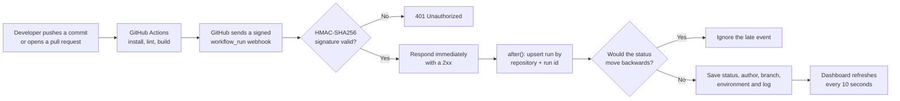
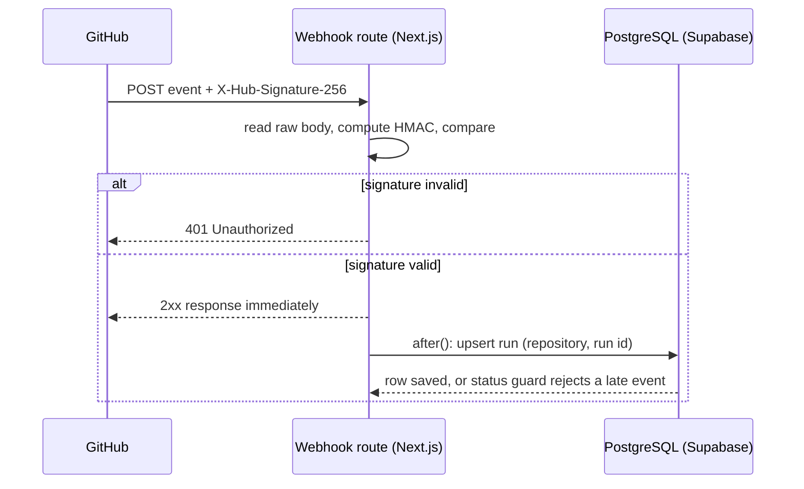
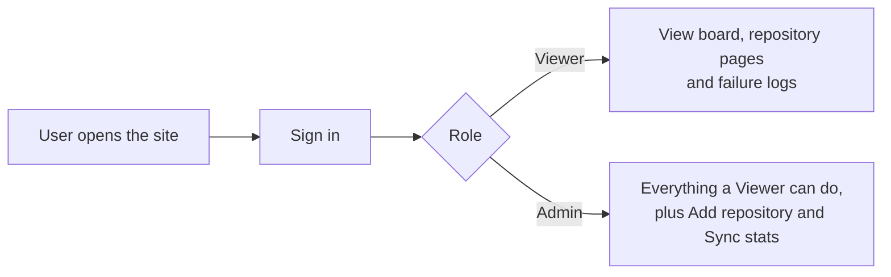
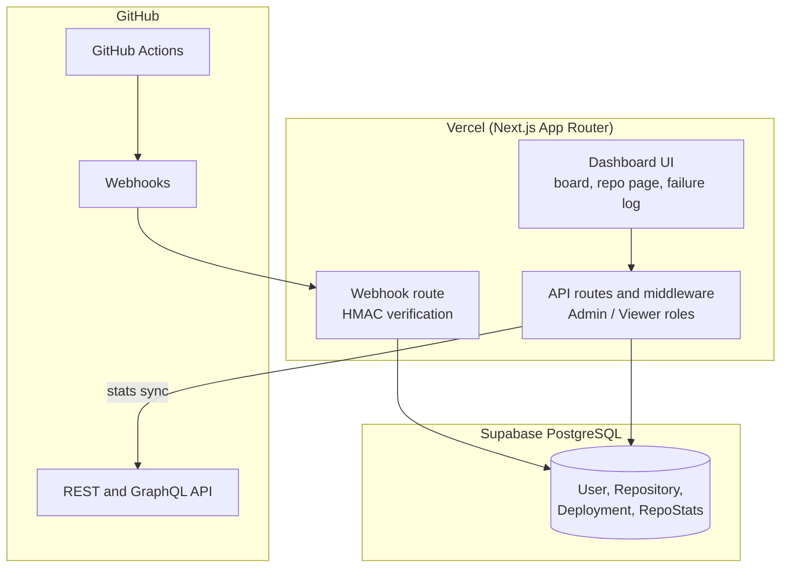
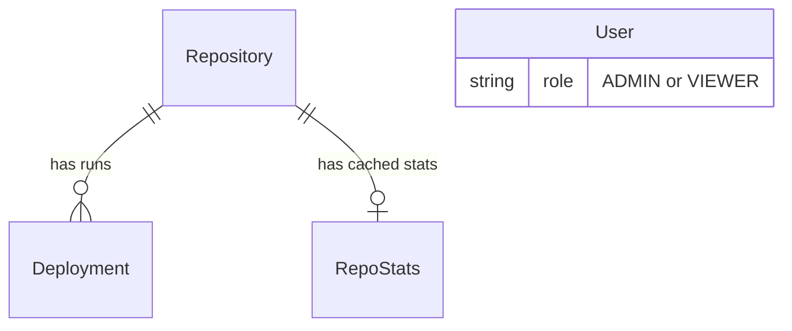

# CI/CD Pipeline Board

**Design and Development of a Web-Based CI/CD Deployment Status Board**

A web dashboard that receives GitHub webhook events, verifies each one with an HMAC-SHA256 signature, stores the results in PostgreSQL, and shows per-repository build status, commit authors and failure logs for Staging and Production. Access is role-based (Admin and Viewer).

**Live application:** https://cicd-pipeline-tracker.vercel.app/ (sign-in required)


---

## Table of contents

1. [Problem and solution](#problem-and-solution)
2. [Features](#features)
3. [Workflow model](#workflow-model)
4. [Architecture](#architecture)
5. [Data model](#data-model)
6. [Tech stack](#tech-stack)
7. [Getting started](#getting-started)
8. [Connecting GitHub](#connecting-github)
9. [Roles](#roles)
10. [Reliability and security](#reliability-and-security)
11. [Testing](#testing)
12. [Project structure](#project-structure)
13. [Screenshots](#screenshots)
14. [Design decisions](#design-decisions)
15. [Known limitations and roadmap](#known-limitations-and-roadmap)
16. [Development process](#development-process)

---

## Problem and solution

**Problem.** Pipeline status is scattered across GitHub Actions logs, email and chat. There is no single place to see whether Production is healthy or who broke the last build. Enterprise CI/CD suites solve this but are heavy and costly for small teams, and a public webhook endpoint can be spoofed unless every request is verified.

**Solution.** An event-driven status board. GitHub pushes an event to the application whenever a workflow run changes. The application verifies the signature, stores the run, and the dashboard displays it. Nothing polls GitHub for build results.

The board is an *observer*, not a CI system: it does not run builds itself, it tracks the pipelines that already run on GitHub Actions.

## Features

- **Signed webhook ingestion.** HMAC-SHA256 verification over the raw request body. Invalid signatures are rejected with `401`.
- **Reliable, ordered storage.** One row per workflow run, upserted by repository and run id. Redeliveries do not create duplicates, and a run's status never moves backwards.
- **Pipeline Status Board.** Cards per repository and environment with a status badge, branch, commit SHA, author and relative time. Summary cards, Staging/Production filters with counts, and a 10-second auto-refresh.
- **Add repository.** An Admin can add a repository by entering `owner/repo`. Added repositories update on refresh and need a webhook for real-time updates.
- **Per-repository page.** Deployment activity (total, passed, failed, success rate), the ten most recent runs, and GitHub statistics (total commits, contributors, stars, open issues, language, last synced).
- **Failure log.** A side panel with the run number, commit, author, branch, environment, the failed step, the reason, and the last 150 lines of the log, with a copy button.
- **Role-based access.** Admin and Viewer roles enforced by middleware.

## Workflow model

### End-to-end workflow



### Webhook request lifecycle



### User workflow



## Architecture



The application uses a **pooled** database connection at runtime and a **direct** connection for migrations (see [Design decisions](#design-decisions)).

## Data model



| Table | Purpose |
|---|---|
| `User` | Accounts for sign-in, each with a role (Admin or Viewer). |
| `Repository` | A tracked GitHub repository (owner and name). |
| `Deployment` | One row per workflow run: run id, commit SHA, author, branch, environment, status and the truncated log. Unique per repository and run id. |
| `RepoStats` | Cached GitHub statistics for a repository, with a last-synced time. |

**Environment inference.** The branch decides the environment: `main` is **Production**, any other branch is **Staging**.

## Tech stack

| Layer | Technology |
|---|---|
| Frontend and backend | Next.js (App Router), TypeScript, Tailwind CSS |
| Authentication | Auth.js v5 (credentials), middleware-based role checks |
| Database | PostgreSQL on Supabase |
| ORM | Prisma 6.19.3 (pinned) |
| CI | GitHub Actions |
| Hosting | Vercel |

## Getting started

### Prerequisites

- Node.js (current LTS) and npm
- A PostgreSQL database (a Supabase project works well)
- A GitHub repository with at least one GitHub Actions workflow to monitor

### Install

```bash
git clone https://github.com/ui-gaurav/cicd-pipeline-tracker.git
cd cicd-pipeline-tracker
npm install
```

### Environment variables

Create a `.env` file in the project root. Never commit it.

| Variable | Purpose |
|---|---|
| `DATABASE_URL` | Pooled connection string (Supabase transaction pooler, port 6543), used at runtime. If you see "prepared statement" errors, append `?pgbouncer=true`. |
| `DIRECT_URL` | Direct connection string (port 5432), used by Prisma migrations. |
| `AUTH_SECRET` | Random secret for Auth.js. Generate one with `openssl rand -base64 32`. |
| `GITHUB_WEBHOOK_SECRET` | Shared secret configured on the GitHub webhook. |
| `GITHUB_TOKEN` | Read-only GitHub token for statistics sync and fetching run details. |
| `SEED_ADMIN_PASSWORD`, `SEED_VIEWER_PASSWORD` | Passwords for the seeded Admin and Viewer accounts. |
| `DEMO_*` (optional) | Enables the demo-account quick fill on the sign-in page. Do not set admin demo credentials in production. |

### Database

```bash
npx prisma generate
npx prisma migrate deploy
npx prisma db seed
```

The seed script creates an Admin account (`admin@cicd.internal`) and a Viewer account (`viewer@cicd.internal`) using the passwords from your `.env`.

### Run

```bash
npm run dev
```

Open http://localhost:3000 and sign in.

## Connecting GitHub

1. In your repository, open **Settings, Webhooks, Add webhook**.
2. **Payload URL:** `https://<your-host>/api/webhooks/github`. For local development, expose the app with a tunnel such as `ngrok http 3000` and use that URL.
3. **Content type:** `application/json`.
4. **Secret:** the same value as `GITHUB_WEBHOOK_SECRET`.
5. **Events:** select **Workflow runs** (add others if you like).
6. Push a commit. A new run appears on the board within the next refresh.

Run results come from `workflow_run` events. `check_suite` events are ignored because they describe the same run. A free tunnel URL changes whenever it restarts, so update the webhook URL when it does.

## Roles

| Capability | Viewer | Admin |
|---|---|---|
| View the status board and repository pages | Yes | Yes |
| View failure logs | Yes | Yes |
| Sync repository statistics | No | Yes |
| Add a repository | No | Yes |

## Reliability and security

| Concern | Handling |
|---|---|
| Forged requests | HMAC-SHA256 over the raw body with a constant-time comparison. `401` on mismatch. |
| Duplicate deliveries | Unique constraint on repository and run id, with an upsert. |
| Out-of-order events | A run's status never moves backwards. |
| Slow responses | GitHub expects a 2xx within about 10 seconds, so the handler responds immediately and writes afterwards. |
| Overlapping events | Only `workflow_run` is processed. |
| Oversized logs | Only the last 150 lines are kept. |
| Unauthorized access | Middleware enforces Admin and Viewer roles on routes. |
| Secrets | Held in environment variables, not in the repository. |

## Testing

`scripts/test-webhook-flow.ts` exercises the webhook flow end to end. All 13 checks passed when last run:

```bash
npx tsx scripts/test-webhook-flow.ts
```

Every push also runs the GitHub Actions workflow in `.github/workflows/ci.yml`: install, Prisma generate, lint and build.

## Project structure

```text
cicd-pipeline-tracker/
├── app/                        # App Router: sign-in page, dashboard, repository pages, API routes
├── prisma/                     # schema.prisma and migrations
├── scripts/
│   └── test-webhook-flow.ts    # end-to-end webhook test (13 checks)
├── .github/workflows/ci.yml    # install, Prisma generate, lint, build
├── auth.config.ts              # Auth.js configuration
├── middleware.ts               # Admin / Viewer route protection
└── package.json
```

## Screenshots

**Sign-in**


**Repository page: deployment activity and GitHub statistics**


**Failure log panel**


## Design decisions

- **Why PostgreSQL on Supabase.** PlanetScale removed its free tier, and Supabase offers a free managed PostgreSQL that works with Prisma and Vercel.
- **Pooled and direct connections.** Migrations need a temporary shadow database, which a transaction pooler cannot support. Migrations therefore use `DIRECT_URL`, and the application uses the pooled `DATABASE_URL`.
- **Prisma pinned to 6.19.3.** An unpinned install resolved a pre-release version (8.0.0-rc.12) whose commands differed from the documented ones. Pinning restored the standard workflow.
- **Raw body for signatures.** Parsing the JSON before hashing changes the bytes being hashed and breaks verification, so the body is read as text and verified first.
- **Respond first, write after.** This keeps GitHub from timing out. The trade-off is that a failed write is not retried automatically; the error is logged, and a delivery can be replayed from the webhook's Recent Deliveries page. The idempotent upsert makes the replay safe.
- **Keyed on the run, not the commit.** One commit can trigger several workflow runs, so the commit SHA would merge distinct runs.

## Known limitations and roadmap

**Known limitations**

- **Polling, not push.** The board refreshes every 10 seconds. A real-time push layer was designed but not implemented.
- **Success rate counts pending runs.** The rate is passed runs divided by all stored runs, so repositories with many runs still pending show a low rate.
- **Environment is inferred from the branch name.** A webhook does not say where code was deployed.
- **Added repositories update on refresh** unless a webhook is configured for them.

**Roadmap**

- Real-time push using a managed service that sends a timestamp-only signal, so data still flows through the authenticated API.
- Success rate over completed runs, with stale pending runs aged out.
- Alerts to Slack or email when a pipeline fails.
- GitHub's Deployments API to replace branch-based environment inference.
- Support for CI providers other than GitHub Actions.

## Development process

The project was built iteratively in five milestones, each ending in a report.

| Milestone | Focus | Outcome |
|---|---|---|
| 1 | Design | Problem, solution, tech stack, architecture and schema design. |
| 2 | Ingestion and access control | Database schema applied, HMAC-verified webhook listener, authentication and roles. |
| 3 | Dashboard and analytics | Status board, repository page, GitHub statistics sync, failure log. |
| 4 | Robustness | Idempotent upsert, ordered status handling, fast acknowledgement, live GitHub webhook. |
| 5 | Deployment and documentation | Live deployment on Vercel, final report and this README. |

## Author

Gaurav Arya, B.Tech Computer Science and Design, MITS Gwalior.